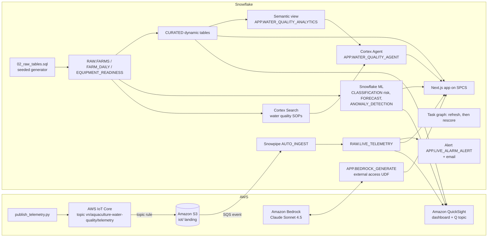

# Vietnam Aquaculture Water Quality Monitor

Pond water quality monitoring for a **fictional aquaculture group's network of 30 farms across 6 Vietnam cities** (Can Tho, Ca Mau, Bac Lieu, Soc Trang, Ben Tre, Rach Gia) using Snowflake, optionally with AWS: from intensive shrimp ponds and super-intensive shrimp raceways through pangasius ponds to shrimp hatcheries and recirculating nurseries, with in-band probe-reading KPIs, a live ammonia alarm, a 7-day water quality event-risk score, an alarm email and an AI action memo.

## Architecture

A water quality monitoring pipeline built on **Snowflake** (Dynamic Tables, Snowflake ML, Cortex Search, Cortex Agent, Cortex AI_COMPLETE, SPCS) and, in the full build, **AWS** (IoT Core, S3, Bedrock Claude, QuickSight + Amazon Q). Pond probes (total ammonia nitrogen, aerator load) land in `RAW.LIVE_TELEMETRY`. Dynamic tables curate 90 days of farm-day history: probe readings, in-band readings (dissolved oxygen, pH, temperature, salinity and ammonia all inside the band for the farm type), parameter checks, alarm checks, water quality events and aeration uptime. Snowflake ML scores 7-day water quality event risk per farm, forecasts network-wide probe-reading volume and flags total ammonia anomalies. A Cortex Agent answers questions with SOP citations, and an LLM drafts the water quality action memo.

Interactive diagrams (hover for object names): [Snowflake only](docs/architecture-snowflake.html) | [AWS + Snowflake](docs/architecture-aws.html). The app shows both on its Architecture & Data tab, the current build first. Regenerate them with `python3 docs/build_architecture.py`.



The Snowflake-only build drops the AWS subgraph: `APP.SIMULATE_TELEMETRY` writes to `RAW.LIVE_TELEMETRY`, and the app calls Cortex `AI_COMPLETE` instead of the Bedrock UDF.

## Snowflake Capabilities

| Capability | Implementation |
|-----------|---------------|
| Dynamic Tables | `CURATED.KPI_SUMMARY`, `PERFORMANCE_SUMMARY`, `WQ_EVENT_CAUSES`, `TREND_ANALYSIS` from the RAW tables |
| Snowflake ML | CLASSIFICATION 7-day water quality event risk (`ML.WQ_EVENT_RISK_SCORES`), 14-day probe-reading volume FORECAST, total ammonia ANOMALY_DETECTION |
| Cortex Search | 20 synthetic water quality response SOPs (one per farm type and cause) in `SEARCH.FARM_SOP_SEARCH` |
| Semantic View | `APP.WATER_QUALITY_ANALYTICS` over farms, event causes, daily probe readings and risk |
| Cortex Agent | `APP.WATER_QUALITY_AGENT`: Cortex Analyst over the semantic view plus Cortex Search for SOP citations |
| Cortex AI | `AI_COMPLETE('claude-sonnet-4-5')` for grounded answers, and for the action memo in the Snowflake-only build |
| Alerts + Tasks | `APP.LIVE_ALARM_ALERT` logs ALARM readings and sends email; task graph `TASK_REFRESH_CURATED`, then `TASK_RESCORE_RISK` |
| Snowpark Container Services | Next.js app `APP.VN_AQUACULTURE_WATER_QUALITY_APP` with 6 tabs: Executive Cockpit, Predictive, Farm Health, Live IoT, Ask AI, Architecture & Data |
| Snowpipe | `RAW.LIVE_TELEMETRY_PIPE` AUTO_INGEST from S3 (AWS build only) |

## AWS Services

Used only in the AWS + Snowflake build.

| Service | Role in Demo |
|---------|-------------|
| AWS IoT Core | Receives simulated pond probe telemetry (total ammonia, aerator load). A topic rule writes each message to S3 |
| Amazon S3 | Landing bucket. An event notification goes to the Snowpipe SQS queue |
| Amazon Bedrock | Claude Sonnet 4.5 writes the action memo, called from Snowflake through an external-access UDF |
| Amazon QuickSight | DIRECT_QUERY executive dashboard over Snowflake (daily in-band probe readings, water quality events by farm, event risk) |
| Amazon Q | Natural-language questions over the QuickSight topic `vn-aquaculture-water-quality-topic` |
| AWS IAM | Least-privilege roles for S3, IoT and Bedrock |

## Personas

These personas are fictional.

| Persona | Role | Key Questions |
|---------|------|---------------|
| **Nguyen Thi Thu Ha** | Farm Operations Director | "Which city has the lowest in-band rate?" "Which event causes push the most readings out of band?" |
| **Le Minh Quan** | Water Quality Lead | "Which farms are high event risk this week, and which SOP applies?" |

## Data

All data is synthetic and seeded, so every rebuild reproduces it. The aquaculture group, its farms and its network are fictional; the six cities are real Vietnam cities used as regions. No real company, farm, hatchery or facility is represented, and no water quality, food safety or regulatory compliance is claimed for any real site.

| Table | Rows | Description |
|-------|------|-------------|
| RAW.FARMS | 30 | Aquaculture farms across 6 cities and 5 farm types (Intensive Shrimp Pond, Super-Intensive Shrimp Raceway, Pangasius Pond, Shrimp Hatchery, Recirculating Nursery) |
| RAW.FARM_DAILY | 2,700 | Daily farm observations over 90 days: probe readings, in-band readings, feed uptake, parameter checks, alarm checks, water quality events, root cause, PM, total ammonia and aerator load |
| RAW.EQUIPMENT_READINESS | 30 | Paddlewheel aerators, air blowers, water pumps, backup generators or dissolved oxygen probes required and on hand per farm |
| SEARCH.FARM_SOP_DOCS | 20 | Synthetic water quality response SOPs indexed for Cortex Search |
| RAW.LIVE_TELEMETRY | Grows during the demo | Live readings from IoT Core (AWS build) or `APP.SIMULATE_TELEMETRY` (Snowflake-only build) |
| ML.WQ_EVENT_RISK_SCORES | 30 | 7-day water quality event probability and risk band per farm |

Pond traceability: each farm-day carries in-band readings and the feed uptake of the ponds it monitored, and every SOP asks technicians to log the affected pond IDs and confirm probe values with a handheld reading.

## Build Instructions

### Prerequisites
- Snowflake account with ACCOUNTADMIN access, and Cortex AI enabled (AI_COMPLETE, Search, Agent).
- An X-Small warehouse with auto-suspend at or below 120 s, and an existing SPCS compute pool.
- Python 3.11+, `snowflake-connector-python`, Node.js 22+, Docker and the `snow` CLI.
- App image: run `snow spcs image-registry login`, then build and push `vn-aquaculture-water-quality-app:v1` to the database's `APP.IMAGES` repository (see the header of `snowflake/07_deploy_app.sql`).
- AWS build only: `boto3`, AWS credentials for the target account (us-west-2) with Bedrock access, and QuickSight Enterprise.

### SPCS App
```
<DATABASE>.APP.VN_AQUACULTURE_WATER_QUALITY_APP
```

### Tests
```bash
python -m pytest aws snowflake quicksight
```

For a local run, put `SNOWFLAKE_ACCOUNT`, `SNOWFLAKE_USER`, `SNOWFLAKE_DATABASE`, `SNOWFLAKE_WAREHOUSE`, `SNOWFLAKE_AUTHENTICATOR=PROGRAMMATIC_ACCESS_TOKEN`, `SNOWFLAKE_TOKEN` and `DEMO_PLATFORM` in the environment, then run `npm --prefix app run build && npm --prefix app start`.

## Build Modes

Both modes share the same core. They differ in three places, and the app's `DEMO_PLATFORM` setting (in its SPCS spec) switches the memo provider and the Live IoT tab.

| Layer | Snowflake Only | Full AWS + Snowflake |
|---|---|---|
| Live telemetry | `CALL APP.SIMULATE_TELEMETRY(n)` inserts simulated readings into `RAW.LIVE_TELEMETRY`. This simulates a sensor feed; it is not Snowpipe Streaming | `aws/publish_telemetry.py` to AWS IoT Core, then S3, SQS and Snowpipe AUTO_INGEST |
| Action memo | Cortex `AI_COMPLETE('claude-sonnet-4-5')` | Amazon Bedrock Claude Sonnet 4.5 through `APP.BEDROCK_GENERATE` |
| BI and natural-language questions | The SPCS app is the dashboard; questions go to the Cortex Agent | Also a QuickSight dashboard and an Amazon Q topic |
| App setting | `DEMO_PLATFORM: snowflake` | `DEMO_PLATFORM: aws` |

### Snowflake Only

```bash
# 1. Core data and dynamic tables (guarded: new isolated database only)
python snowflake/run_core.py --database VIETNAM_AQUACULTURE_WATER_QUALITY_SNOWFLAKE --warehouse <XS_WAREHOUSE> --connection <CONNECTION> --apply
# 2. Native telemetry, ML, search, semantic view, agent, alert and task graph
python snowflake/run_intelligence.py --database VIETNAM_AQUACULTURE_WATER_QUALITY_SNOWFLAKE --platform snowflake --warehouse <XS_WAREHOUSE> --connection <CONNECTION> --alert-email you@example.com
# 3. App on SPCS with DEMO_PLATFORM=snowflake (push the image first)
python snowflake/run_intelligence.py --database VIETNAM_AQUACULTURE_WATER_QUALITY_SNOWFLAKE --platform snowflake --warehouse <XS_WAREHOUSE> --connection <CONNECTION> --alert-email you@example.com --files 07_deploy_app.sql --compute-pool <COMPUTE_POOL>
```

During the demo:
- Run `CALL APP.SIMULATE_TELEMETRY(20)` to add live readings. For a continuous feed, run `ALTER TASK APP.TASK_SIMULATE_TELEMETRY RESUME`, and `SUSPEND` it afterwards.
- Run `EXECUTE ALERT APP.LIVE_ALARM_ALERT` to raise the alarm email.
- Run `EXECUTE TASK APP.TASK_REFRESH_CURATED` to refresh the curated tables and rescore risk.

Afterwards, drop the database or run `ALTER SERVICE APP.VN_AQUACULTURE_WATER_QUALITY_APP SUSPEND`.

### Full AWS + Snowflake

```bash
# 1. Core data and dynamic tables (guarded: new isolated database only)
python snowflake/run_core.py --database VIETNAM_AQUACULTURE_WATER_QUALITY_AWS --warehouse <XS_WAREHOUSE> --connection <CONNECTION> --apply
# 2. AWS ingestion and Bedrock (dry run first, then --apply)
python aws/setup_aws.py --database VIETNAM_AQUACULTURE_WATER_QUALITY_AWS --account <AWS_ACCOUNT_ID> --connection <CONNECTION> --apply
# 3. ML, search, semantic view, agent, alert and task graph
python snowflake/run_intelligence.py --database VIETNAM_AQUACULTURE_WATER_QUALITY_AWS --platform aws --warehouse <XS_WAREHOUSE> --connection <CONNECTION> --alert-email you@example.com
# 4. App on SPCS with DEMO_PLATFORM=aws (push the image first)
python snowflake/run_intelligence.py --database VIETNAM_AQUACULTURE_WATER_QUALITY_AWS --platform aws --warehouse <XS_WAREHOUSE> --connection <CONNECTION> --alert-email you@example.com --files 07_deploy_app.sql --compute-pool <COMPUTE_POOL>
# 5. QuickSight dashboard and Q topic (needs an existing Snowflake data source)
python quicksight/build_dashboards.py --database VIETNAM_AQUACULTURE_WATER_QUALITY_AWS --account <AWS_ACCOUNT_ID> --principal-arn <QUICKSIGHT_USER_ARN> --data-source-arn <DATA_SOURCE_ARN> --prefix vn-aquaculture-water-quality --apply --update --with-topic
```

QuickSight objects must be shared with the QuickSight user who signs in (`--principal-arn`); otherwise the console shows nothing.

During the demo:
- Run `python aws/publish_telemetry.py --count 20` to send live readings.
- Run `EXECUTE ALERT APP.LIVE_ALARM_ALERT` to raise the alarm email.
- Run `EXECUTE TASK APP.TASK_REFRESH_CURATED` to refresh the curated tables and rescore risk.

Afterwards, `python aws/teardown_aws.py --database VIETNAM_AQUACULTURE_WATER_QUALITY_AWS --account <AWS_ACCOUNT_ID> --connection <CONNECTION> --apply` removes the AWS resources and the account-level Bedrock external-access and S3 storage integrations. It leaves the email integration `VN_AQUACULTURE_WATER_QUALITY_EMAIL_INT`, which the Snowflake-only build also uses.

## Business Impact

Industry context from the Food and Agriculture Organization of the United Nations (FAO), *The State of World Fisheries and Aquaculture 2024*:
- **Aquaculture now leads aquatic animal production**: "In 2022 and for the first time in history, aquaculture surpassed capture fisheries as the main producer of aquatic animals." -- [FAO newsroom, SOFIA 2024](https://www.fao.org/newsroom/detail/fao-report-global-fisheries-and-aquaculture-production-reaches-a-new-record-high/en)
- **Viet Nam is one of the ten countries that dominate aquaculture**: "Ten of them – China, Indonesia, India, Viet Nam, Bangladesh, the Philippines, Republic of Korea, Norway, Egypt, and Chile – produced over 89.8 percent of the total." -- [same FAO page](https://www.fao.org/newsroom/detail/fao-report-global-fisheries-and-aquaculture-production-reaches-a-new-record-high/en)
- **Growth has to be sustainable**: "future expansion and intensification must prioritise sustainability and benefit regions and communities most in need." -- [same FAO page](https://www.fao.org/newsroom/detail/fao-report-global-fisheries-and-aquaculture-production-reaches-a-new-record-high/en)

These are global industry figures, not outcomes of this demo or of any Vietnam farm.

## Key Demo Numbers

These figures are synthetic and come from the seeded demo data. Forecast and anomaly figures can shift slightly with the build day.

- **30 farms**, 2,700 farm-days over 90 days, across 6 cities and 5 farm types; **987,152 probe readings**
- **In-band probe readings 90.1%**; per-farm in-band rate ranges from 87.7% to 92.4%, and Soc Trang is the lowest city at 89.4%
- **395 water quality events** across 14 root causes; aerator motor failure pushes the most readings out of band
- **Event-risk model** out-of-time holdout: precision 0.62, recall 0.61 at a 0.5 threshold, against a 0.55 base rate (a modest lift; present it as triage). 19 farms are high risk; the top farm is WQ-0019, at 96.7%
- **14-day probe-reading volume forecast** with prediction intervals; **53 of 480** farm-days flagged as total ammonia anomalies
- **Aeration uptime 98.2%**, aeration equipment readiness 81.0%, 18.82 alarms per 1,000 parameter checks
- **20 SOPs** indexed for Cortex Search and cited by ID in agent answers

## License

Apache 2.0 — See [LICENSE](LICENSE) for details.

This is a personal demo project and is not an official Snowflake offering. It comes with no support or warranty. Industry metrics cited are from publicly available third-party research; they describe the industry and are not guarantees of results.
